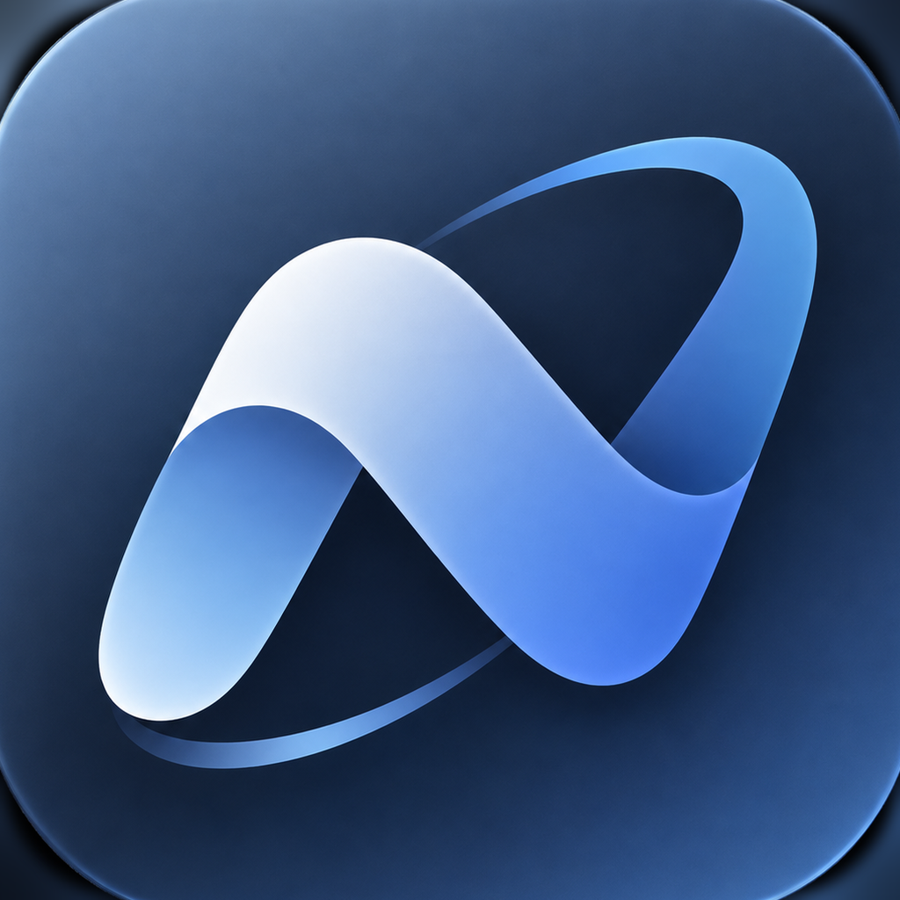

# Neutrin Browser

Un navegador para iOS, más tranquilo y **centrado en la privacidad**. Bloquea anuncios y rastreadores, y tiene modo oscuro para webs y modo lectura. Está hecho en **SwiftUI** y usa **WebKit** (WKWebView), el motor que Apple exige a todos los navegadores de iOS.



## Privacidad

| Función | Cómo funciona |
|---|---|
| **Shields: bloqueo de anuncios y rastreadores** | Dos niveles: **(1)** una lista propia de unos 190 servicios (DoubleClick, Taboola, Google Analytics, píxel de Meta…) que funciona sin conexión desde el primer momento; **(2)** las listas comunitarias **EasyList** (anuncios) y **EasyPrivacy** (rastreadores), con más de 100.000 reglas, que se **descargan y actualizan solas** cada 4 días. Todo se bloquea **antes de cargar** con las reglas nativas de WebKit (`WKContentRuleList`), y también se ocultan los huecos que dejan los anuncios. |
| **Panel de Shields** | El escudo de la barra de direcciones muestra qué se bloqueó en la página y permite apagar Shields en un sitio concreto (la página se recarga). |
| **Estadísticas** | La página de inicio muestra cuántos anuncios y rastreadores se han bloqueado en total. |
| **Enlaces limpios** | Quita parámetros de rastreo (`utm_*`, `fbclid`, `gclid`, `msclkid`…) de los enlaces que abres, compartes o guardas. |
| **Global Privacy Control** | Indica a las webs que no vendan ni compartan tus datos (`navigator.globalPrivacyControl` y la cabecera `Sec-GPC` en las páginas que abres tú). |
| **HTTPS** | Cambia a HTTPS los sitios que lo admiten y avisa (⚠︎) cuando una conexión no es segura. |
| **Pestañas privadas** | No guardan historial, y sus cookies y datos se borran al cerrarlas. Comparten un almacén en memoria que se descarta al cerrar la última. |
| **Buscadores privados** | DuckDuckGo por defecto. También incluye Brave Search, Startpage, Ecosia, Google y Bing. |
| **Datos locales** | Todo se guarda solo en el dispositivo, cifrado con la protección de archivos de iOS. No hay cuentas ni telemetría. |

### Cómo se actualizan EasyList y EasyPrivacy

1. La app descarga la lista de `easylist.to` (si falla, usa el espejo de adblockplus.org), con `ETag`/`If-Modified-Since` para no bajarla de nuevo si no ha cambiado.
2. `NeutrinFilterConverter.js` convierte la sintaxis de Adblock Plus a reglas de WebKit dentro de **JavaScriptCore**, en segundo plano. Es el mismo código que se prueba en `ScriptTests`.
3. WebKit compila las reglas y las guarda en caché, así que en los siguientes arranques están listas al instante.
4. Las reglas que WebKit no puede expresar (expresiones regulares, filtros "procedurales", `$redirect`, `$csp`, `$popup`…) se omiten en lugar de adivinarlas.

En **Ajustes → Filter Lists** puedes activar o desactivar cada lista, ver cuántas reglas tiene, cuándo se actualizó y forzar una actualización.

## Lectura y apariencia

- **Modo lectura**: en artículos aparece un icono 📄 en la barra. El texto se extrae con [Mozilla Readability](https://github.com/mozilla/readability), el mismo motor que usa Firefox, y se muestra limpio. Puedes cambiar el tamaño de letra, elegir entre serif y sans, y usar tema automático, claro, sepia u oscuro. La vista de lectura funciona **sin JavaScript de la página, sin cookies** y con Shields activado.
- **Modo oscuro para webs**: Apagado, Igual que el sistema o Siempre. Invierte las páginas claras sin estropear fotos ni vídeos, y respeta las webs que ya tienen diseño oscuro.

## Pantallas

| Pantalla | Qué hace |
|---|---|
| **Inicio** | Buscador con escáner QR, accesos rápidos, tarjeta de Shields con estadísticas, Favoritos y Recientes. |
| **Navegador** | Barra flotante: atrás/adelante, escudo con contador, dirección, modo lectura, pestañas y menú (compartir, favoritos, modo oscuro, pestaña privada…). |
| **Tabs & Spaces** | Pestañas por *Spaces* (Personal, Trabajo, Estudio…), una sección **Private** y la gestión de spaces. |
| **Ajustes** | Shields, privacidad, buscador, apariencia, modo lectura y borrado de datos. |

## Requisitos

- Xcode 16 o posterior y [XcodeGen](https://github.com/yonaskolb/XcodeGen) (`brew install xcodegen`)
- iOS 17 o posterior (iPhone)

## Cómo ejecutarlo

```sh
xcodegen generate
open NeutrinBrowser.xcodeproj
```

El proyecto de Xcode no se guarda en el repositorio, se genera desde `project.yml`. Elige tu equipo en *Signing & Capabilities* (o usa el simulador) y pulsa ▶︎.

## Compilación y TestFlight (GitHub Actions)

`.github/workflows/ios.yml` se ejecuta en cada push (salvo en la rama `certificados`):

- **build:** genera el proyecto, pasa las pruebas XCTest en el simulador y crea un IPA sin firmar. Una de las pruebas compila las reglas de bloqueo con el compilador real de WebKit, incluidas EasyList y EasyPrivacy completas.
- **scripts:** prueba los scripts de las páginas y el conversor de listas con Node, usando las listas EasyList y EasyPrivacy reales.
- **testflight** (solo en `main`): firma la app con fastlane `match` (el certificado se guarda en la rama `certificados`) y la sube a TestFlight. Necesita estos secrets del repositorio: `ASC_KEY_ID`, `ASC_ISSUER_ID`, `ASC_KEY_P8` y `APPLE_TEAM_ID`.

Antes de la primera subida, la app tiene que existir en App Store Connect con el bundle ID **`com.lfaz.neutrin`**.

## Estructura

```
NeutrinBrowser/
├── App/            Punto de entrada y RootView (inicio ↔ navegador)
├── Models/         Space, Tab, Favorite, History, SearchEngine, URLResolver
├── Store/          BrowserStore (estado + persistencia), TabController (WKWebView)
├── Privacy/        Lista propia, EasyList/EasyPrivacy (FilterListManager + conversor), LinkCleaner
├── Reader/         Modo lectura: modelos, plantilla HTML y vista
├── Resources/      Scripts JS (Shields, modo oscuro, GPC, Readability)
├── Views/          HomeView, BrowserView, TabsSpacesView, ShieldsPanel, ajustes, escáner QR
├── DesignSystem/   Colores, efecto glass, logo vectorial, ilustraciones
└── Assets.xcassets
NeutrinBrowserTests/   Pruebas XCTest (incluye compilar reglas con WebKit)
ScriptTests/           Pruebas en Node de los scripts y del conversor
fastlane/              Firma y subida a TestFlight
project.yml            Definición del proyecto (XcodeGen)
```

## Pruebas de los scripts

Los scripts que se inyectan en las páginas y el conversor de listas (`NeutrinBrowser/Resources/Scripts`) se pueden probar con Node y jsdom: informe de Shields, conversión de filtros, modo oscuro, detección de artículos y GPC. Si pones `easylist.txt` y `easyprivacy.txt` en `ScriptTests/`, también se comprueba la conversión de las listas completas.

```sh
cd ScriptTests && npm install && npm test
```

## Créditos

- [EasyList y EasyPrivacy](https://easylist.to), del equipo de EasyList. La app las descarga directamente; no se incluyen en el repositorio.

- [Mozilla Readability](https://github.com/mozilla/readability) 0.6.0, licencia Apache 2.0 (ver `NeutrinBrowser/Resources/Scripts/Readability-LICENSE.txt`).
